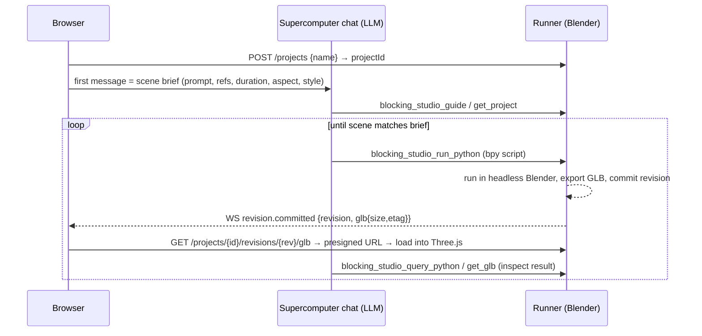

# Higgsfield 3D Jutsu — reverse-engineering notes

Source: public marketing pages, the public TanStack/Vite JS bundles served from
`assets.higgsfield.ai` for the `/3d-jutsu` route (build hash `fe1792b7`), the
route translation files, and third-party write-ups. No authenticated endpoint
was called. Everything below is observable from the client code or published
material; where something is inferred it is marked **(inferred)**.

Snapshot date: 2026-10-13.

---

## 1. What the product is

3D Jutsu is Higgsfield's browser "previz / blocking" workspace. Internally it is
called **Blocking Studio** (`blocking_studio` analytics name, `blocking-studio`
and `3d-scene-builder` are old route prefixes that 301 to `/3d-jutsu`). It
launched 2026-09-04 as a Supercomputer (Higgsfield's agent workspace) app.

The loop is:

1. You write a scene brief (prompt + optional reference images + duration,
   aspect ratio, style).
2. An LLM agent builds the scene **by writing and running Blender Python** on a
   hosted headless-Blender "runner". The `.blend` file is the source of truth.
3. After each operation the runner **checkpoints the scene to a GLB**, which the
   browser loads into a Three.js viewport.
4. You edit the scene by hand (move/rotate/scale, add primitives, lights,
   cameras, camera-rig paths, Mixamo characters). Those edits go back to the
   runner as small JSON **scene operations**, which it applies to the `.blend`.
5. "Generate" renders the camera timeline **in the browser** (WebCodecs) to an
   MP4 and drops it into the project's chat; the agent then calls Higgsfield's
   video models (Seedance 2.5 in the marketing demo) using the clip as a
   camera/timing reference, plus Soul character/location images.

So the "3D model" is never generated by a 3D diffusion model. It is proxy
geometry (grey blockout) authored procedurally by an LLM through `bpy`, with
the final look coming from a video model that conditions on the previz clip.

---

## 2. Architecture

```
Browser (React / TanStack Start, Clerk auth)
 ├── Composer (landing page)  --sessionStorage "blocking-studio:pending-brief"--> /3d-jutsu/{projectId}
 ├── Studio page
 │    ├── Three.js viewport  (GLTFLoader+Draco+Meshopt, OrbitControls, TransformControls, GLTFExporter)
 │    ├── Supercomputer chat embed (folder == project; LLM agent with blocking_studio_* tools)
 │    ├── Timeline / camera-rig editor (20 presets, Catmull-Rom paths, DoF focus)
 │    └── Exporter (mediabunny + WebCodecs → mp4/avc or webm/vp9/av1, GLB, PNG)
 │
 ├── REST  https://3d-scene-builder.higgsfield.ai   (VITE_BLENDER_RUNNER_URL, "project service" / "runner")
 └── WS    wss://3d-scene-builder.higgsfield.ai/projects/{id}/events?ticket=…

Runner (server side, inferred)
 ├── per-project .blend + revision history + GLB artifacts (presigned S3-style upload/download)
 ├── operation queue:  queued → hydrating → starting → running → checkpointing → succeeded|failed|timed_out|expired
 │     ("hydrating" = load .blend, "starting" = boot Blender, "checkpointing" = export GLB + commit revision)
 ├── applies browser scene-operations (JSON) to the .blend, with per-entity leases for collaboration
 └── exposes tools to the agent (see §5)

Supercomputer agent (LLM: default openai/gpt-6-astra; user-selectable)
 └── tools: blocking_studio_run_python, blocking_studio_query_python, blocking_studio_import_asset,
            blocking_studio_search_assets, blocking_studio_guide, blocking_studio_get_project,
            blocking_studio_get_operation, blocking_studio_get_glb, blocking_studio_get_blend,
            blocking_studio_get_artifact  (+ the normal higgsfield_generate_video / motion_control etc.)
```

Sequence for "prompt → scene":



---

## 3. Runner REST API (from the client SDK chunk `fe1792b7-Ec1jmTlwBtD5eh74.js`)

All calls: `Authorization: Bearer <Clerk session token>`; on 401 the token is
refreshed once (`skipCache`) and retried. Errors come back as
`{error:{message, code, retryable}}`. Base URL = runner URL, trailing slash
stripped.

| Method | Path | Body / query | Returns |
|---|---|---|---|
| GET | `/projects?limit=24&cursor=` | | `{projects[], nextCursor}` |
| POST | `/projects` | `{name}` (default "Untitled 3D Jutsu") | `{project:{id}}` |
| DELETE | `/projects/{id}` | | |
| GET | `/projects/{id}/collaboration?after=N` | | `{revision, sceneSequence, appliedSequence, entities[], operations[], leases[]}` |
| POST | `/projects/{id}/scene-operations` | `{operations:[{operationId, actorId, baseSequence, entityId, expectedEntityVersion?, lease?, kind, payload}]}` | `{collaboration:{revision, sceneSequence, operations:[…status accepted\|conflicted, entityVersionAfter]}}` |
| GET | `/projects/{id}/revisions?cursor&limit` | | `{revisions[], nextCursor}` |
| POST | `/projects/{id}/revisions/{rev}/restore` | `{operationId}` | `{operation}` + `Location` header to poll |
| GET | `/projects/{id}/operations/{opId}` | | `{operation:{status, error?}}` (+ `retry-after`) |
| GET | `/projects/{id}/glb` and `/revisions/{rev}/glb` | | `{download:{url,method,headers}, artifact:{revision,size,etag}}` |
| POST | `/projects/{id}/revisions/{rev}/glb-uploads` | `{contentLength}` | `{upload:{id, transfer:{url,method,headers}}}` then direct PUT of the GLB |
| GET | `/projects/{id}/scene-assets/{assetId}` | | `{download:{…}, artifact:{assetId}}` |
| POST | `/projects/{id}/entity-leases` | `{entityId, clientSessionId, displayName?}` | `{lease:{leaseId, fence, expiresAt…}}` |
| POST | `/projects/{id}/entity-leases/renew` | `{entityId, clientSessionId, lease}` | |
| POST | `/projects/{id}/entity-leases/release` | same | |
| POST | `/projects/{id}/event-ticket` | `{profile}` | `{ticket}` (one-shot WS auth) |
| GET | `/curated-assets?search=&limit=100` | | `{total, items:[{id,name,tags,glb_url}]}` (separate host, unresolved) |

Client-side rules worth copying:

- Operation polling: honour `retry-after` (cap 5 s, default 1 s), give up after
  5 min with `CLIENT_POLL_TIMEOUT`.
- Uploading a GLB revision fails with `SCENE_NOT_SETTLED` until
  `appliedSequence == sceneSequence`; the client polls `/collaboration` every
  250 ms (120 s timeout, `SCENE_SETTLE_TIMEOUT`) and retries.
- Presigned downloads retry 3× with 700 ms × n backoff on 403/404/408/429/5xx.
- The project list query key is `['blocking-studio', …]`; curated assets cache
  5 min.

### WebSocket events (`/projects/{id}/events?ticket=`)

Server → client:

| type | payload |
|---|---|
| `presence.snapshot` / `presence.joined` / `presence.updated` / `presence.left` | participants `{connectionId, userId, displayName, avatarUrl, canWrite, canExecute, connectedAt, presence:{selection[], editingEntityId, updatedAt}}` |
| `entity.lease.snapshot` / `entity.lease.acquired` / `entity.lease.released` | lease `{entityId, leaseId, fence, holderUserId, holderDisplayName, acquiredAt, expiresAt}`; release reason `released\|expired\|committed` |
| `entity.transform.preview` / `.cancelled` / `.rejected` | live drag of another user; rejected reasons `LEASE_NOT_ACTIVE`, `RATE_LIMITED` |
| `scene.operation.committed` / `scene.operation.conflicted` | a scene operation; conflict reasons `AI_DELETED_ENTITY`, `ENTITY_REMOVED` |
| `scene.checkpointed` | `{revision, sceneSequence, glb:{size,etag}}` — browser edits folded into a new GLB |
| `revision.committed` | `{operationId, revision, glb}` — an agent operation finished |
| `operation.updated` | `{operationId, status, baseRevision, revisionAfter, errorCode}` |

Client → server: `presence.update`, `entity.transform.preview` (dropped when
`bufferedAmount > 64 KB`), `entity.transform.preview.cancel`. Reconnect with
exponential backoff 1 s·2ⁿ capped at 15 s, fetching a fresh ticket each time.

---

## 4. Scene data model

Entities (`/collaboration.entities[]`):

```ts
{ id: string<=128, kind: 'object'|'camera'|'light'|'world'|'timeline',
  deleted: boolean, version: int, lastSequence: int,
  state: { name?, transform?, projection?, rig?, properties?, material?, settings?, timeline? } }
```

Reserved ids: `__world__` (kind world) and `__timeline__` (kind timeline).

```ts
Transform  = { position:[x,y,z], rotation:[x,y,z,w] /*quaternion*/, scale:[x,y,z] }
Material   = { baseColor:[r,g,b,a], metallic:0..1, roughness:0..1 }
Projection = { type:'perspective', near>0, far>near, verticalFov:(0,π) rad }
           | { type:'orthographic', near>=0, far>near, verticalSize>0 }
Light      = { type:'directional'|'point'|'spot', color:[r,g,b], intensity>=0, castShadow,
               range?:null|>0 /*point,spot*/, innerConeAngle<=outerConeAngle<=π/2 /*spot*/ }
           | { type:'unsupported' }           // anything Blender has that the viewer can't edit
World      = { type:'solid', color:[r,g,b], strength>=0 }
CameraRig  = { aspect:null|>0, dofFocusName:null|string, path:null|Path, animation:null|Anim }
Path       = { id, name, transform, waypoints:[{id,name,transform}] (<=256),
               aim:null|{…}, focus:null|{…}, focusParent:'aim'|'path',
               anchor:null|{origin:[3], focus:[3], radius>=0},
               settings:{ enabled, closed, bounce,
                          curve:'centripetal'|'chordal'|'catmullrom',
                          aim:'tangent'|'target'|'fixed',
                          easing:'linear'|'in'|'out'|'inout',
                          framing:'close'|'medium'|'wide',
                          tension:0..1, duration:(0,600] s (×2 if bounce), roll, intensity, speed,
                          targetName:null|string, presetId:null|string } }
Anim       = { name, duration:(0,600], times:[2..20000 ascending], positions:[3n], quaternions:[4n] }
Timeline   = { shots:[{ cameraId, start, end, … }] }
```

Scene-operation kinds the browser can emit (`kind` + `payload`):

| kind | payload |
|---|---|
| `object.create.primitive` | `{primitive:'box'\|'plane'\|'uvSphere'\|'cylinder'\|'cone', name?, transform}` |
| `object.create.from_glb` | `{assetId, name?, transform}` (curated asset or uploaded GLB) |
| `entity.transform.set` / `object.transform.set` / `camera.transform.set` | `{transform}` |
| `object.material.set` | `{material}` |
| `entity.rename` / `object.rename` | `{name}` |
| `entity.delete` / `object.delete` | `{}` |
| `camera.create` | `{name?, transform, projection}` |
| `camera.projection.set` | `{projection}` |
| `camera.rig.set` | `{rig}` |
| `camera.active.set` | `{}` |
| `light.create` | `{name?, transform, properties}` |
| `light.properties.set` | `{properties}` |
| `world.settings.set` | `{settings}` |
| `timeline.shots.set` | `{timeline}` |

Each op carries `baseSequence` (optimistic concurrency against
`sceneSequence`) and optionally `expectedEntityVersion` + a `lease`. The
runner answers `accepted` or `conflicted`.

### GLB extras the runner writes (Three.js `userData`)

`blockingStudioEntityName`, `blockingStudioCharacter`, `blockingStudioTimeline`,
`blockingStudioDofFocus`, `blockingStudioAspect`, `blockingStudioPathFor`,
`blockingStudioWaypoint`, `blockingStudioWaypointIndex`,
`blockingStudioSharedResources`, `blockingStudioEnabled`. Older files use the
`blenderGlbLab*` prefix and are migrated on load. Camera paths are therefore
stored **inside the GLB as empties** (waypoint nodes tagged with
`blockingStudioPathFor = <cameraName>` and an index), not in a side file.

---

## 5. The agent side

The studio page is the Supercomputer chat with the project as its folder. The
agent's tool set (names from the tool-renderer map in the chat bundle):

| tool | what it does **(inferred from name + UI copy)** |
|---|---|
| `blocking_studio_guide` | returns the authoring guide / conventions the LLM must follow |
| `blocking_studio_get_project` | project metadata, current revision, entity list |
| `blocking_studio_run_python` | execute a `bpy` script in the project's Blender → new revision + GLB |
| `blocking_studio_query_python` | read-only `bpy` query (inspect objects, bounds, names) without a revision |
| `blocking_studio_search_assets` | search the curated GLB library (same `/curated-assets` index the UI uses) |
| `blocking_studio_import_asset` | import a curated/uploaded GLB into the scene |
| `blocking_studio_get_operation` | poll an operation's status |
| `blocking_studio_get_glb` / `get_blend` / `get_artifact` | fetch artifacts (GLB, .blend, renders) for inspection |

Evidence that geometry comes from Blender Python rather than a 3D generator:
the runner host is literally `VITE_BLENDER_RUNNER_URL`, the agent tools are
`run_python`/`query_python`/`get_blend`, the operation lifecycle has a
"hydrating → starting" phase (process boot), and chat @-mentions of scene
objects are serialised as `<hf-blender-entity>{"id","kind","name"}</hf-blender-entity>`.
A separate generic Supercomputer tool `higgsfield_generate_3d` exists for
image→mesh, but it is not part of the blocking-studio tool group.

Brief hand-off from the landing composer: the composer stores
`sessionStorage["blocking-studio:pending-brief"] = {projectId, prompt, files, settings}`
with defaults `{duration:15 (1–60), aspectRatio:'16:9' (16:9|9:16|1:1|4:3|3:4|21:9), style:'blocking'|'detailed'}`,
creates the project (`POST /projects`), navigates to `/3d-jutsu/{projectId}`,
and the studio posts the brief as the first chat message ("Scene brief for
the AI agent"). `style:'blocking'` = grey proxies; `'detailed'` presumably lets
the agent add materials/assets **(inferred)**.

LLM options seen in the bundle: `openai/gpt-6-astra` (default), `gpt-5.5`,
`gpt-5.5-pro`, `gpt-5.4-mini`, `gpt-5.2`, `gpt-5.1`, `gpt-5`, `gpt-5-mini`,
`gpt-4o-mini`, `gpt-4.1-mini`, `google/gemini-3.1-pro-preview`,
`gemini-3.1-flash-lite-preview`, `gemini-orchestrator`,
`anthropic/claude-fable-5`, `claude-opus-4.7`, `claude-sonnet-4.6`,
`claude-haiku-4.5`. The blog adds GLM-5.3 Flash, DeepSeek V4 Flash, Seed 2.1
Turbo, Gemini 3.5 Flash. Pricing is per chat message (Auto free, GPT-6 Astra
~17 credits, Claude Fable ~11, Opus ~8, GPT-5.6 Sol ~7, Gemini 3.1 Pro ~3…).

---

## 6. Browser viewer / editor

- Three.js (examples build; GLTFLoader with DRACOLoader + MeshoptDecoder,
  GLTFExporter, OrbitControls, TransformControls). Editor and character
  modules are lazy chunks (`getEditorModules`, `getCharacterModules`).
- Default proxy material for new primitives: `MeshStandardMaterial({color: 0xB7B7C9, roughness: 0.5})`.
- Characters: Mixamo rigs fetched from the three.js r178 example models on
  jsDelivr — `Xbot.glb` ("Y Bot": idle, walk, run, nod, headShake, sad/sneak
  poses…), `Michelle.glb` (samba dance, T-pose), `Soldier.glb` ("Vanguard":
  3 motions). Clips become GLTF animations on export.
- Camera-rig presets (20), each a `build(anchor)` producing waypoints around an
  anchor frame `{origin, focus, radius, height, right, horizontal}`:

  | group | ids |
  |---|---|
  | orbit | `orbit-half` (Orbit 180), `arc-left`, `arc-right`, `figure-eight`, `spiral-up`, `spiral-down` |
  | dolly | `dolly-in`, `dolly-out`, `push-in-low`, `truck-left`, `truck-right`, `s-curve` |
  | crane | `crane-up`, `crane-down` |
  | aerial | `flyover`, `drone-pullback` |
  | reveal | `reveal-behind` |

  Example: `dolly-in` = three points at 1.6×, 1.1×, 0.6× radius along the
  view axis, `aim:'target'`, 6 s. `figure-eight` = 8 points on a lemniscate
  (`sin(2θ)` along the horizontal axis, `sin θ` along right), closed, 16 s.
  Rig settings defaults: intensity 1 (clamped 0.25–2), framing medium, speed 1;
  framing scale close ≈ 0.72.
- Timeline: shots reference cameras; `timeline.shots.set` is emitted when the
  user re-orders or trims.
- Undo/redo is local; "Save current version" = `flushSceneEdits()` → wait for
  settle → `GLTFExporter.parseAsync(editableRoot, {animations, binary:true, onlyVisible:false})`
  → `POST …/glb-uploads` → direct PUT. Restore = `POST …/revisions/{rev}/restore`.
- Collaboration: before dragging an entity the client acquires a lease
  (`entity-leases`), streams `entity.transform.preview` over WS during the
  gesture, and commits a `*.transform.set` operation at the end. Roles:
  admin / collaborator / viewer (`canWrite`, `canExecute`).

### Export / "Generate"

- Requires WebCodecs (`VideoEncoder`); otherwise "Video export needs WebCodecs".
- `renderTimelineVideo()` renders each timeline frame off-screen at
  `fps = 30`, max width 1920, and encodes with **mediabunny**
  (`CanvasSource`, `Mp4OutputFormat`/`WebMOutputFormat`, `QUALITY_HIGH`,
  `keyFrameInterval: 2`), codec preference `avc` → mp4, else `vp9`/`av1` → webm.
  File name `3d-jutsu-<project>-<ts>.mp4`.
- The blob is uploaded to the project's chat folder as an attachment and a
  message like "<N>s preview rendered" is sent, so the agent (not the viewer)
  performs the video-model call. Marketing copy: "Press Export. Seedance 2.5
  renders your 3D take into the finished shot." Only camera path and figure
  motion are meant to carry over; materials, lighting and proxy geometry are
  not **(stated in the blog)**.
- Static frame (PNG) and GLB export use the same pipeline.

---

## 7. Other facts

- Desktop only: the route loader returns `access: {status:'outside', reason:'device-ineligible'}` on phones.
- Project URLs `/3d-jutsu/{uuid}`; analytics page name `blocking_studio_project`;
  events `blocking_studio_project_{started,completed,failed}`,
  `blocking_studio_export_{started,completed,failed}`.
- Auth: Clerk (`clerk.higgsfield.ai`, hosted mode). Other Higgsfield hosts seen:
  `fnf-api-gw.higgsfield.ai` (generation API), `canvas-worker`, `layer-worker`,
  `creator-hub-chat`, `open.higgsfield.ai` (public API), `cdn`/`static`.
- The Blender **plugin** ("Higgsfield in Blender", Aug 21 2026) shares the
  same Scene Builder backend; the web app is that plugin's runner exposed in a
  browser.

---

## 8. How to build an equivalent

Minimal clone that reproduces the behaviour above:

1. **Runner**: a container with headless Blender (`blender -b --python-expr`)
   per project, a `.blend` per project on disk/S3, and an HTTP API with the
   endpoints in §3. Each `run_python` request: load `.blend` → exec script in
   a sandboxed namespace with `bpy` → save → `bpy.ops.export_scene.gltf(binary, extras=True)`
   → store GLB as revision N+1 → emit `revision.committed`.
   Write camera rigs / DoF targets / timeline into object custom properties
   so they round-trip through GLB `extras`.
2. **Agent**: any tool-calling LLM with tools `guide`, `get_project`,
   `run_python`, `query_python`, `search_assets`, `import_asset`, `get_glb`.
   The guide should pin conventions: metres, Z-up in Blender (viewer converts),
   name every object, use proxies (`primitive_cube_add` etc.), keep a
   `__world__` background and a `Camera` with `aspect` set from the brief,
   never delete user-created entities unless asked (the conflict reason
   `AI_DELETED_ENTITY` exists because this happens).
3. **Viewer**: Three.js + GLTFLoader; map GLB extras → entity records; emit
   JSON scene operations for hand edits; apply the same operations to the
   `.blend` server-side via a small `bpy` interpreter (`object.create.primitive`
   → `bpy.ops.mesh.primitive_*_add`, `*.transform.set` → `obj.matrix_world`,
   `light.properties.set` → `light.data.energy/color/spot_size`, …).
4. **Collab**: WebSocket with presence, per-entity leases with a fence number,
   transform previews; operations carry `baseSequence` for optimistic
   concurrency.
5. **Render & hand-off**: render the timeline in the browser with WebCodecs
   (mediabunny is the library they use) and send the clip to a video model
   that accepts a reference video for camera/motion (Seedance 2.5, Kling
   motion control, Wan 2.6 video reference) with a prompt that says to use the
   reference only for camera, timing and placement.

A cheaper variant (GPTunneL's "3D Scene" node) skips Blender entirely: the
LLM emits a tiny DSL of primitives + camera keyframes (~300 tokens with
macros), a browser WebGL renderer produces the reference clip, and the video
model does the rest. That loses GLB/character import but needs no server-side
3D at all.

---

## 9. What could not be determined

- The text of `blocking_studio_guide` (the agent's authoring rules) and the
  system prompt.
- The Blender version, GPU/CPU, timeouts and sandboxing of the runner.
- The exact prompt/parameters used when the previz clip is sent to Seedance
  2.5 (which model slot: text2video with video reference vs motion control).
- The host behind `/curated-assets` (built by a helper in a chunk that was not
  resolvable from the static bundle).
- Tool-status label strings for `blocking_studio_*` (their i18n ids are not
  in the public translation files for the two routes fetched).
